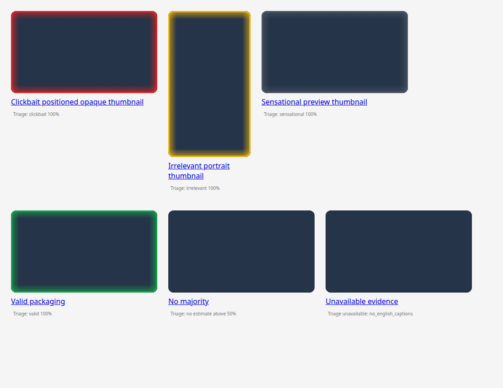

# YouTube Clickbait Triage

An experimental Chrome/Chromium extension that compares a video's displayed
title and actual thumbnail with its original English captions, then adds a
subtle category rim to the thumbnail.

Analysis uses **local Gemma**, not Gemini or cloud inference. YouTube metadata,
captions and thumbnail images still require network access.

> This is a research prototype, not a verified working release. YouTube layouts
> and access restrictions can break discovery or retrieval. A reported live
> “nothing is running” problem has not yet been reproduced or resolved.
> Passing automated tests does not establish classification accuracy.



*Demo UI using synthetic video cards and deterministic test scores—not a live assessment or accuracy demonstration.*

## What it does

The extension sends the viewer-facing title, thumbnail URL and individual video
URL to a Python companion through Chrome Native Messaging. The companion
retrieves the actual image and bounded, complete original English captions
before running a multi-stage local classification.

| Category | Rim | Meaning |
| --- | --- | --- |
| Clickbait | Red | Subject-relevant packaging makes a materially misleading or undelivered claim. |
| Irrelevant | Yellow | A material subject promised by the title or thumbnail is substantively off-topic. |
| Sensational | Dark gray | Supported subject matter uses exaggerated or emotionally loaded framing. |
| Valid | Green | Supported, fair, non-sensational packaging. |

A category receives a frame only when its estimate is **strictly above 50%**.
Exactly 50%, no majority, pending work and unavailable evidence remain unframed.
Scores are uncalibrated model estimates, not measured probabilities or verified
facts. Frames stay above thumbnails and hover previews without intercepting clicks.

Up to **three distinct packages run concurrently across all YouTube tabs**, with
64 waiting. Duplicates share work; a changed title or full thumbnail URL triggers
fresh analysis. One private runtime is configured for three inference lanes;
stages within each analysis remain sequential.

## Requirements and model caveat

Setup currently targets Linux x86-64, Python 3.12+, `uv`, Node.js 22+,
Chrome/Chromium, and `curl`, `tar`, `zstd` and `flock`. UI tests also use npm
and Playwright. The reference machine uses an NVIDIA laptop GPU; other GPU/CPU
configurations and operating systems are not verified.

**Model setup is not a portable one-command bootstrap.** The default import
requires an already-obtained, exact Gemma 4 E4B decoder GGUF with SHA-256:

```text
90ce98129eb3e8cc57e62433d500c97c624b1e3af1fcc85dd3b55ad7e0313e9f
```

Obtain matching weights under their applicable terms. This repository does not
distribute weights or identify arbitrary Gemma downloads as interchangeable.
The preparation script defaults to the matching blob under
`$HOME/.ollama/models/blobs/`; alternatively set `TRIAGE_GEMMA_CORE` to its
absolute file path.

The script copies and hash-verifies the decoder, downloads and verifies its
compatible projector, then imports a **custom composition** named
`youtube-triage-gemma4-e4b:poc`. This is not an official `gemma4:e4b` package.
Runtime checks require Gemma 4 vision support; there is no silent text-only or
different-model fallback.

The 32k text and 8k image contexts can cause substantial memory pressure on an
8GB GPU. Three-way scheduling is not a promise of three-times throughput;
offloading or runtime reloads can make individual analyses slow.

## Install the local prototype

Clone and install the project dependencies:

```bash
git clone https://github.com/aydin41k/youtube-clickbait-triage.git
cd youtube-clickbait-triage
uv sync
```

Only after meeting the exact decoder requirement above, prepare the runtime:

```bash
# Omit this export if the exact decoder is already at the default blob path.
export TRIAGE_GEMMA_CORE=/absolute/path/to/matching-gemma4-core.gguf
./scripts/setup-local-ollama.sh
```

Setup downloads a pinned Ollama runtime and compatible projector. Models live
in this clone's `.models/`; runtime files and operational logs live in
`.runtime/`. The companion uses loopback port **11435**, bypasses inference
proxies, and holds a project ownership lock. It refuses to borrow, replace or
stop another session's server. Setup does not replace system Ollama.

Load and register your own extension:

1. Open `chrome://extensions` and enable **Developer mode**.
2. Choose **Load unpacked** and select this clone's `extension/` directory.
3. Copy the extension's 32-character ID, then register it:

```bash
uv run python scripts/install-native-host.py YOUR_EXTENSION_ID
```

Registration defaults to the current user's Google Chrome native-host directory.
Chromium or a nonstandard profile may need its matching directory through
`--config-dir /absolute/path/to/NativeMessagingHosts`. Conflicting manifests
are refused, not overwritten. Keep the clone at its registered path.

Open or refresh a supported YouTube page containing individual video cards and
check the extension popup.

## Controls and command-line use

- **Pause / Resume** stops or resumes new work. Pause disconnects the companion
  and interrupts active attempts; their inference extent is unknown.
- **Retry** clears cached classifications and resets the companion connection.
- **Runs & results** shows current/queued work and bounded attempt summaries.
  Clearing completed activity does not resume work or clear the classification cache.

After updates, reload the extension in `chrome://extensions`, refresh YouTube,
and close/reopen the old companion connection, for example with Pause then Resume.
An already-running process does not acquire new code or settings in place.

The same classifier can be called from the terminal:

```bash
./run-poc --help
./run-poc --url 'https://www.youtube.com/watch?v=VIDEO_ID' \
  --title 'The title actually displayed to the viewer' \
  --thumbnail 'https://i.ytimg.com/vi/VIDEO_ID/hqdefault.jpg' --json
```

Replace `VIDEO_ID` with a real 11-character video ID. CLI inference needs the
same prepared model and exclusive runtime ownership as the extension.

## Captions, reliability and accuracy limits

Manual original English JSON3 captions are preferred, followed by original
automatic English. Regional/script variants such as `en-AU` are eligible;
translated `tlang` tracks and non-English sources are not. Blocked, empty,
malformed or partial preferred tracks can fall back to eligible alternatives.
Only the successful track supplies evidence and provenance: partial tracks
are never combined, and descriptions are never substituted for transcripts.

Retrieval has one 120-second deadline, at most two metadata extractions and
four caption downloads total, including retries. Transport failures and HTTP
429/5xx use bounded, cancellation-aware backoff. The working JS-less path is
tried first; one metadata refresh can use Node and bundled `yt-dlp-ejs==0.8.0`.
No remote JavaScript components, browser cookies or shell profiles are used.
Node resolves through an absolute `TRIAGE_NODE` override, PATH, then standard
Linux paths, including when Chrome has a minimal GUI PATH.

Missing captions, access/PO-token restrictions, rate limits, extraction/setup
failures and incomplete evidence can still make analysis unavailable.
Caption interval completeness is heuristic, not full audiovisual viewing.
Automatic captions can be wrong; footage, music or visual demonstrations may
need evidence this prototype cannot assess. Speaker statements are not
independent scientific verification. No accuracy or speed benchmark is claimed.

## Troubleshooting

- **Nothing starts:** check Pause, refresh YouTube and confirm individual
  eligible video cards were discovered. Collection tiles are excluded; individual
  playlist video entries are supported.
  Check the popup's connection/error and queue state. The reported live
  no-dispatch issue remains unverified; this README is not a claim it is fixed.
- **Native host unavailable/disconnected:** check the extension ID, browser
  registration directory, executable `run-native-host` and the clone's
  `.venv/bin/python`. Re-register if the clone moved; resolve conflicting
  manifests explicitly.
- **Private runtime busy / port occupied:** close the owning project session.
  Do not kill or commandeer unrelated Ollama services.
- **Unavailable / missing captions:** inspect the specific reason in Runs &
  results. Restrictions or incomplete original English evidence can prevent
  scoring. Retry later when a transient block clears; do not expect fabricated
  evidence or automatic endless retries.

## Privacy and storage

Inference stays local; YouTube network requests still occur. No cloud model,
cookies or browser credentials are used. Model history/request logging is disabled.
The extension keeps up to 100 validated input/result summaries and Pause in
browser-session RAM, including submitted titles, video/thumbnail URLs, scores
and available timings. Raw captions, image bytes and model responses are not
stored in browser activity. Scored results are cached for one hour; unavailable
results for 60 seconds, with no automatic retry loop.

Default CLI runs do not retain raw evidence. `--save-evidence DIRECTORY` is an
explicit opt-in that writes images, captions, provenance and raw model responses;
treat that directory as private. Runtime logs contain operational diagnostics.

This public snapshot intentionally omits private proof artifacts, generated
outputs, model/runtime files, browser profiles and original development history.
The screenshot is a synthetic test fixture, not personal browsing.

## Development and tests

```bash
uv sync
npm ci
npm test
uv run python -m unittest discover -s tests -v
npm run test:browser
uv run python -m compileall -q poc.py triage_core.py native_host.py scripts/install-native-host.py
git diff --check
```

Browser tests need a compatible Playwright Chromium installation. Set
`TRIAGE_TEST_CHROMIUM=/absolute/path/to/chromium` to use an existing executable;
otherwise they use `chromium.executablePath()`. Tests isolate their browser
profiles, use synthetic pages and fake framed classifiers, and do not run the
local model. They verify contracts, scheduling, ownership/shutdown, caption
fallbacks and UI behavior—not real-world classification accuracy.
